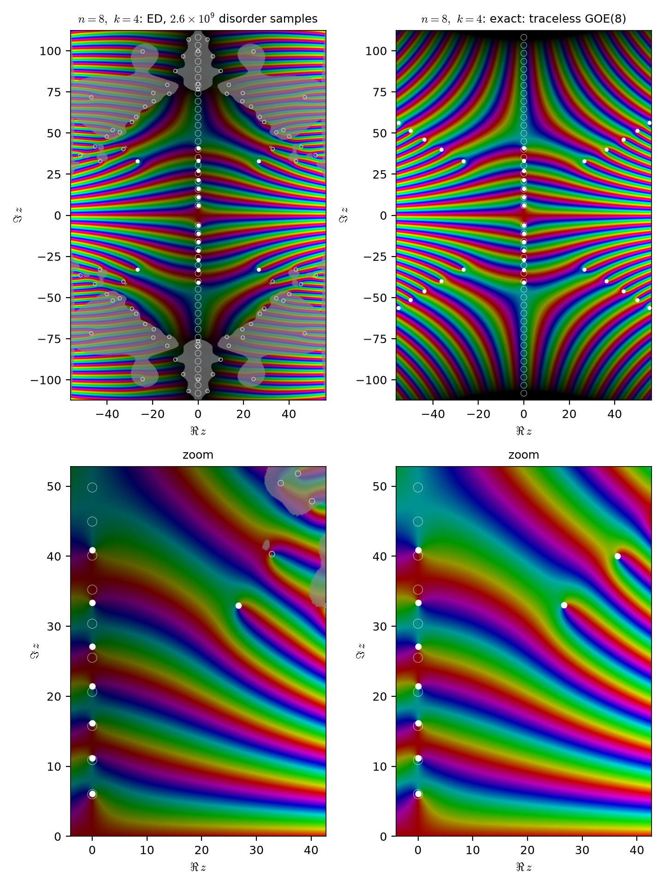

# syk-roots

Numerical supplement to A. Basu and S. Midha, *Lee-Yang theorems for q-deformed oscillators and doubly-scaled SYK*:
zeros of the annealed SYK partition function in the complex plane, computed by exact diagonalization,

$$Z_n(z) = \mathbb{E}_{\boldsymbol g}\, \mathrm{tr}\, e^{z H_{\rm SYK}(\boldsymbol g)}, \qquad
H_{\rm SYK} = \sigma_{n,k} \sum_{|S|=k} g_S \Gamma_S,\quad \sigma_{n,k}^2 = \frac{(k-1)!}{2k\,n^{k-1}},$$

with $g_S$ i.i.d. $\mathcal N(0,1)$, $\Gamma_S = i^{k(k-1)/2}\gamma_{i_1}\cdots\gamma_{i_k}$ and $\mathrm{tr}$ the
normalized trace, as in Sec. 5 of the manuscript. Theorem 1.4 there states that the zeros of $Z_n$ approach the
imaginary axis as $n,k\to\infty$ with $k^2/n\to\alpha$; Remark 1.5 states that at finite size $Z_n$ need not be
imaginary-rooted, e.g. at $n=8$, $k=4$. Below we give the zeros at $n=8$, $k=4$ both by ED and in closed form, and
the zeros for even $n\le18$ (and $n\le24$ to follow) with $k\in\{2,4,6,8\}$.

Throughout, $t=\sqrt{V_n}\,z$ with $V_n=\mathbb E\,\mathrm{tr}H_{\rm SYK}^2=\sigma_{n,k}^2\binom nk$. This is the variable in
which the comparator of Lemma 5.2, $Q_n(z)=\mathcal L_{q_n}(\sqrt{V_n}z)$, has its zeros at $\pm i\,t_j(q_n)$. Zeros come in
sets $\{\pm z,\pm\bar z\}$; only the first quadrant is listed.

## Results

### n = 8, k = 4 (Remark 1.5): ED and closed form



**Left: ED.** Annealed over $2.6\times10^9$ disorder samples ($\sqrt{V_8}=0.3202$).
**Right: exact.** For $n=8$ the Majoranas have a real representation, so every $\Gamma_S$ ($|S|=4$) is real
symmetric. In each fermion-parity sector $\Gamma_{S^c}=\pm\Gamma_S$. The 35 operators $\{\Gamma_S: 1\in S\}$ restricted
to a sector are traceless and orthonormal for the normalized trace, and 35 is exactly the dimension of the traceless
real symmetric $8\times8$ matrices. Hence

$$H_{\rm SYK}\big|_{\pm} = \sum_{S\ni 1}(g_S\pm g_{S^c})\,\Gamma_S\big|_{\pm} \;\stackrel{d}{=}\; c\,H_0,\qquad
H_0 = \text{traceless GOE}(8),\quad c^2=\tfrac{3}{128},$$

independently in the two sectors. Feeding Mehta's exact finite-$N$ GOE density through the Laplace transform gives,
with $w=cz$ (`goe.py`),

$$Z_{8,4}(z)=\frac{e^{-w^2/16}}{92160}\Big[e^{w^2/4}\big(w^{10}+90w^8+6540w^6+62520w^4+159120w^2+92160\big)
+\sqrt\pi\,e^{w^2/2}\,\mathrm{erf}(w/2)\big(1920w^7+20160w^5+50400w^3+25200w\big)\Big].$$

On the imaginary axis this is $e^{-3y^2/16}\,G(y)/92160$ with
$G(y)=P(-y^2)-2D(y/2)R(y)$, where $D$ is the Dawson function. $G$ has exactly **7 positive zeros** and is then
dominated by $-y^{10}$. So $Z_{8,4}$ has exactly 14 zeros on $i\mathbb R$, and **all its other zeros lie off the
axis**, along four rays at about $45^\circ$ (`exact_n8k4.py`).

| exact t = √V z | exact z | ED zero (t) | ED − exact, in jackknife σ |
|---|---|---|---|
| 1.9582 i | 6.115 i | 1.9582 i | 1.1 |
| 3.5648 i | 11.133 i | 3.5648 i | 1.6 |
| 5.1868 i | 16.198 i | 5.1868 i | 1.7 |
| 6.8728 i | 21.463 i | 6.8728 i | 0.2 |
| 8.6758 i | 27.093 i | 8.6758 i | 0.1 |
| **8.5393 + 10.5721 i** | **26.667 + 33.015 i** | **8.553 ± 0.017 + (10.548 ± 0.026) i** | **0.9** |
| 10.6806 i | 33.354 i | 10.6807 i | 1.5 |
| 13.0870 i | 40.869 i | 13.0868 i | 1.5 |
| 11.659 + 12.825 i, 14.008 + 14.744 i, 15.973 + 16.448 i, … | | not resolved by ED (noise veil) | |

Every resolved ED zero agrees with an exact zero to within 1.7σ. This includes the off-axis quadruplet
$z\approx\pm26.7\pm33.0\,i$, whose real part is about 500σ from zero in ED. The 22 ED zeros that the resolved
criterion rejected (grey rings) have no exact counterpart; they are Monte Carlo noise, which calibrates the
criterion used for the other $(n,k)$. Tables: [results/exact_n8_k4.md](results/exact_n8_k4.md),
[results/zeros_n8_k4.md](results/zeros_n8_k4.md).

### Range of (n, k)

All panels use the common window $|\Re t|\le18$, $|\Im t|\le36$. White dots are resolved zeros, grey rings are
unresolved ones, open white circles are the zeros of $Q_n$, and the grey veil marks where the noise
exceeds 40% of $|Z|$. Single-$(n,k)$ figures in $z$ over the full analysis window follow in the
gallery below; tables are in `results/`.


| k | n | first resolved off-axis zero (t) | resolved zeros on the axis below it |
|---|---|---|---|
| 4 | 8 | 8.553 + 10.548 i | 7 |
| 4 | 10 | none resolved (axis zeros resolved up to t = 28.2) | 15 |
| 4 | 12 | 5.475 + 29.034 i | 15 |
| 4 | 14 | 1.81 + 62.65 i | 33 |
| 4 | 16 | none (all resolved zeros on the axis, up to t = 56.8) | 35 |
| 4 | 18 | none (up to t = 77.2) | 49 |
| 6 | 10 / 14 / 18 | none (up to t = 28.2 / 117.5 / 119.0) | 15 / 62 / 75 |
| 6 | 12 / 16 | 0.462 + 13.870 i / 0.086 + 27.864 i (a row of near-axis pairs) | 7 / 16 |
| 8 | 14 / 16 / 18 | none (up to t = 117.5 / 107.2 / 119.3) | 62 / 63 / 75 |
| 2 | 8 – 18 | between 0.25 + 7.96 i and 1.34 + 11.19 i at every n | 2 – 7 |

[results/summary.md](results/summary.md) has all pairs.

#### Each (n, k) in the variable z (click to enlarge)

<!-- gallery -->
<table>
<tr><th></th><th>n=8</th><th>n=10</th><th>n=12</th><th>n=14</th><th>n=16</th><th>n=18</th></tr>
<tr><th>k=2</th><td><a href="figs/zeros_n8_k2.png"></a></td><td><a href="figs/zeros_n10_k2.png"></a></td><td><a href="figs/zeros_n12_k2.png"></a></td><td><a href="figs/zeros_n14_k2.png"></a></td><td><a href="figs/zeros_n16_k2.png"></a></td><td><a href="figs/zeros_n18_k2.png"></a></td></tr>
<tr><th>k=4</th><td><a href="figs/zeros_n8_k4.png"></a></td><td><a href="figs/zeros_n10_k4.png"></a></td><td><a href="figs/zeros_n12_k4.png"></a></td><td><a href="figs/zeros_n14_k4.png"></a></td><td><a href="figs/zeros_n16_k4.png"></a></td><td><a href="figs/zeros_n18_k4.png"></a></td></tr>
<tr><th>k=6</th><td><a href="figs/zeros_n8_k6.png"></a></td><td><a href="figs/zeros_n10_k6.png"></a></td><td><a href="figs/zeros_n12_k6.png"></a></td><td><a href="figs/zeros_n14_k6.png"></a></td><td><a href="figs/zeros_n16_k6.png"></a></td><td><a href="figs/zeros_n18_k6.png"></a></td></tr>
<tr><th>k=8</th><td></td><td><a href="figs/zeros_n10_k8.png"></a></td><td><a href="figs/zeros_n12_k8.png"></a></td><td><a href="figs/zeros_n14_k8.png"></a></td><td><a href="figs/zeros_n16_k8.png"></a></td><td><a href="figs/zeros_n18_k8.png"></a></td></tr>
</table>
<!-- /gallery -->

#### Where the zeros leave the axis


* **Approach to the axis.** For k = 4, 6 and 8 the off-axis zeros move outward as n grows. By n = 16–18 every
  zero resolved in windows up to $|t|\approx 120$ lies on the imaginary axis, as Theorem 1.4 predicts for
  $n\to\infty$. For k = 4 the first off-axis zero roughly tracks $|t|\sim\sqrt{2D}$ with $D=\binom nk$ (dotted
  line). Open triangles mark (n,k) with no resolved off-axis zero, plotted at the largest resolved axis zero.
  A heuristic for that scale: integrating out the overall coupling scale $|\boldsymbol g|\sim\chi_D$ damps the
  oscillations of $Z_n(it)$ beyond $|t|\sim\sqrt{2D}$.
* **k = 2 (free fermions)** has off-axis zeros at $|t|\approx 6$–11 at every n up to 18. Here $q_n=e^{-8/n}\to1$, so
  no Lee–Yang limit is expected.
* **k = 6 at n = 12, 16** (n ≡ 0 mod 4) has a regular row of near-axis pairs, Re t ≈ 0.1–2.4, robust to $10^{-3}$.
  At the same (n,k) the fixed-$|\boldsymbol g|$ spectrum has an anomaly at E = 0 on the scale of one level spacing:
  the density there is 0.15× (n = 12) and 1.7× (n = 16) the smooth value, versus ≈1 at n = 10, 14, 18. This is
  consistent with the particle-hole structure of q ≡ 2 (mod 4) SYK at n ≡ 0 (mod 4). It is a finite-size effect,
  whose scale shrinks with the level spacing.
* **Duality.** $\Gamma_S\Gamma_{[n]}\propto\Gamma_{S^c}$, so (n,k) and (n,n−k) have the same $Z_n$ in $t$.
  The independent runs agree accordingly: (12,4) and (12,8) give $5.475+29.034i$ and $5.474+29.034i$; (8,2)/(8,6) and
  (10,2)/(10,8) agree as well.

#### Axis zeros against the q-oscillator


* **q-oscillator comparison.** On-axis zeros $t_j$ against $t_j(q)$, maximum relative deviation over the first ≤10:

  | | k=4, n=12 | n=14 | n=16 | n=18 | k=6, n=18 | k=8, n=18 |
  |---|---|---|---|---|---|---|
  | $q_n=e^{-2k^2/n}$ | 8.9% | 9.9% | 9.2% | 8.6% | 0.7% | 0.0% |
  | exact $\tilde q=\mathbb E(-1)^{\lvert S\cap T\rvert}$ | 3.5% | 2.4% | 0.8% | 0.4% | 0.2% | 0.0% |

  With $\tilde q$ (the value that matches $\mathbb E\,\mathrm{tr}H^4=V_n^2(2+\tilde q)$), $\mathcal L_{\tilde q}(\sqrt{V_n}z)$
  locates the finite-n axis zeros to under 1% from n ≈ 16. Unlike $e^{-2k^2/n}$, $\tilde q$ also respects the
  k ↔ n−k duality.

Results for n = 20, 22, 24 (parity blocks of dimension 2⁹–2¹¹) will be added.

## Method

* **ED.** $n$ Majoranas on $n/2$ qubits (Jordan–Wigner). Each $\Gamma_S$ is a Pauli string $i^p X^x Z^z$. For one
  disorder sample, $\sum_S g_S\Gamma_S$ is built in $O(N^2\log N)$ ($N=2^{n/2}$): scatter the couplings into
  $C[x,z]$, apply a Walsh–Hadamard transform over $z$, and read $H[b\oplus x,b]=W[x,b]$. Even $k$ conserves
  fermion parity, so the two $N/2$ blocks are diagonalized separately (`sykmaj.py`).
* **Annealed average with the radius integrated out exactly.** Write $\boldsymbol g = r\,\hat{\boldsymbol g}$ with
  $r\sim\chi_D$, $D=\binom nk$, independent of the direction. For each sampled $\hat{\boldsymbol g}$ with spectrum
  $a_j$, $\mathbb E_r \cosh(z\sigma r a_j) = {}_1F_1(D/2;1/2;z^2\sigma^2a_j^2/2)$ is computed with a 16-node
  Gauss rule for $\chi_D$ (machine precision). $Z_n$ is even because $\boldsymbol g\to-\boldsymbol g$ flips the
  spectrum. The second moment $\mathbb E\,\mathrm{tr}H^2=V_n$ is then exact, and the fourth moment is checked
  against $V_n^2(2+\tilde q)$, $\tilde q = \binom nk^{-1}\sum_j(-1)^j\binom kj\binom{n-k}{k-j}$.
* **Storage.** The weighted eigenvalue atoms $\lambda\ge 0$ are binned with 16 Taylor moments per bin, so
  $Z_n(z)=\sum_{b,p}S_{bp}\,z^p\cosh^{(p)}(zc_b)/p!$ can be evaluated anywhere afterwards. The truncation error is below
  $10^{-18}$ in every window used. Samples are split into 16 groups to get jackknife errors (`annealed.py`).
* **Zeros.** On a grid in the first quadrant whose cells straddle the imaginary axis, cells with non-zero phase
  winding are polished by Newton. The count is checked strip by strip with an adaptive argument-principle
  contour integral, and mismatched strips are re-searched by recursive subdivision. Because $Z_n$ is even and
  real on $\mathbb R$, zeros come as $\{\pm z,\pm\bar z\}$, and a simple zero on $i\mathbb R$ cannot leave the axis
  under Monte Carlo noise. Off-axis zeros are therefore a genuine signal once their real part exceeds its error.
* **Resolved zeros.** For each zero we compute jackknife errors of $\Re,\Im$ and the local noise
  $\mathrm{std}_{\rm jk}Z/|Z|$ on a ring of radius $d/2$ around it. A zero counts as *resolved* when the noise is $<0.4$,
  the error is $<1/5$ of the distance $d$ to the nearest other zero, the zeros recomputed from two disjoint halves of
  the samples differ by $<d/5$, and, for off-axis zeros, $\Re z > 5\,\mathrm{err}$. The halves check guards against
  a failure the jackknife cannot see: at large $\Re z$ the average is weighted by $e^{\Re z\,\lambda}$, so rare
  large-eigenvalue samples can dominate it.
* **Closed form at n = 8, k = 4** (`goe.py`, `exact_n8k4.py`): via the traceless GOE(8), evaluated with
  scipy's complex erf. It agrees with a 40-digit mpmath evaluation to $2\times10^{-12}$ over the plotted window.
* **q-oscillator comparison.** The finite-$n$ comparator of Lemma 5.2, $Q_n(z)=\mathcal L_{q_n}(\sqrt{V_n}z)$,
  $q_n=e^{-2k^2/n}$, has zeros $\pm i\,t_j(q_n)/\sqrt{V_n}$. Here $t_j(q)$ are computed from a truncated Jacobi
  matrix of $a_q+a_q^*$, i.e. the Gauss rule of the $q$-Gaussian (`qosc.py`). They are drawn as open circles.

## Reproduce

```
python tests/test_syk.py                                   # Majorana algebra, builder vs dense, estimator checks
python sample.py --n 8 --k 4 --samples 1000000 --seed 1 --out out/n8_k4/s1.npz
python analyze.py out/n8_k4/*.npz --out results/n8_k4      # zeros + jackknife errors -> json, plotting grid -> npz
python exact_n8k4.py results/n8_k4.json --out results/exact_n8_k4   # exact n=8, k=4 zeros vs ED (needs sympy)
python plot_roots.py results --out figs
python summarize.py results --readme README.md             # tables + refresh the figure gallery above
```

`della/` holds the Slurm scripts used on Princeton's Della cluster.
